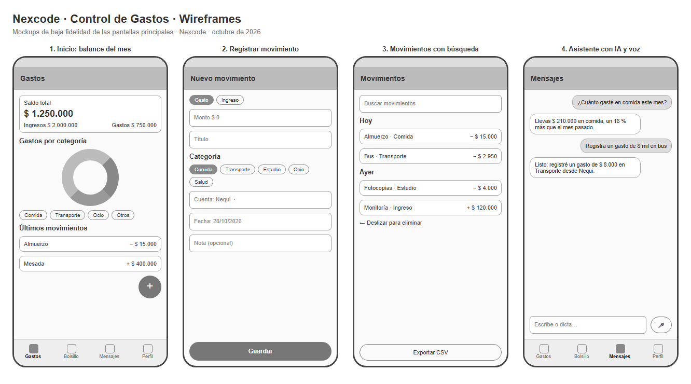

# Nexcode · Control de Gastos · Mockups

Wireframes de baja fidelidad de las cuatro pantallas principales. Muestran la distribución de los elementos y la navegación, no los colores ni la tipografía finales (Jetpack Compose con Material 3). El archivo `mockups/wireframes.html` es editable y se abre en cualquier navegador.

| # | Pantalla | Elementos principales | Requisitos |
|---|---|---|---|
| 1 | Inicio: balance del mes | Saldo total con ingresos y gastos, gráfico de dona por categoría, últimos movimientos y botón flotante para registrar | RF-05, RF-06 |
| 2 | Registrar movimiento | Tipo (gasto o ingreso), monto, título, categoría, cuenta, fecha y nota | RF-01, RF-04 |
| 3 | Movimientos | Buscador, movimientos agrupados por día, deslizar para eliminar y exportar a CSV | RF-02, RF-07, RF-10 |
| 4 | Asistente con IA y voz | Conversación con el asistente, campo de texto y botón para dictar | RF-03, RF-09 |

**Navegación:** barra inferior con cuatro secciones (Gastos, Bolsillo, Mensajes y Perfil); registrar movimiento, movimientos y cuentas se abren desde Gastos.

**Criterios de diseño:**
- **Registrar un gasto toma un toque** desde la pantalla principal (botón flotante) o una frase dictada.
- **El saldo es lo primero que se ve** al abrir la app.
- **Los montos se validan antes de guardar,** así que la pantalla nunca recibe una excepción.
